# Systemhärtung eines Ubuntu Linux-Servers

**Modul:** 182 – Systemsicherheit implementieren
**Auftrag:** Praktische Übung Systemhärtung (Kompetenzband C)
**Name:** David
**Datum:** 28.11.2026

---

## 1. Angestrebte Stufe

Ich strebe die **Stufe I (C1I)** an: Stufe B (Schritte 1–3) plus Lynis-Vergleich vorher/nachher, Szenario Onlineshop und zwei umgesetzte Lynis-Suggestions.

## 2. Lab-Umgebung

| Komponente | Details |
| :--- | :--- |
| Virtualisierung | VMware Workstation, Netzwerk NAT |
| Betriebssystem | Ubuntu Server 26.04.1 LTS |
| Ressourcen | 2 vCPU, 4 GB RAM, 25 GB Disk (LVM, Root-Volume ca. 10 GB) |
| Hostname / IP | `m182-ubuntu-hardening` / `192.168.3.129` |
| Benutzer | `david` (aus der Installation, Gruppe `sudo`) |

Ich habe bewusst **26.04 LTS** statt der empfohlenen 24.04 gewählt, weil man einen neuen Server heute auf der aktuellen LTS aufsetzen würde. Ein Unterschied: 26.04 verwendet standardmässig **sudo-rs** (sudo in Rust), für den Auftrag ändert das nichts.

Vor allen Änderungen habe ich den Snapshot `00 – Vanilla nach Installation` erstellt.

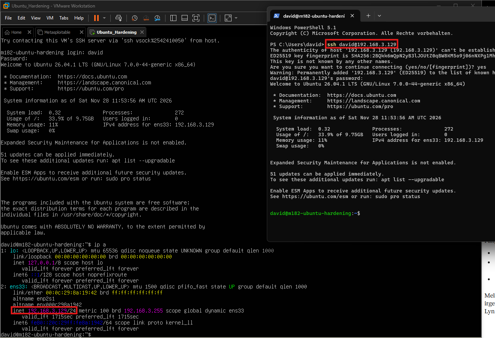

---

## 3. Ist-Zustand analysieren

Alle Ausgaben habe ich mit `tee` gespeichert, siehe [`ist-analyse/`](./ist-analyse/).

| Bereich | Befund |
| :--- | :--- |
| **Offene Ports** (`ss -tuln`) | Von aussen nur **SSH 22/TCP**, aber auf IPv4 (`0.0.0.0`) **und IPv6** (`[::]`). DNS (53), chrony (323) nur localhost. |
| **Dienste** | 21 laufende Dienste. Unnötig auf einer VM: **ModemManager** und **multipathd**. |
| **Benutzer** | Login-Shell nur bei `root` und `david`. In `sudo` nur `david`. root ist gesperrt (`passwd -S root` → `L`). |
| **SSH** (`sshd -T`) | `permitrootlogin prohibit-password`, `passwordauthentication yes` |
| **Firewall** | `ufw status` → `inactive` |
| **IPv6** | Aktiv, Link-Local-Adresse `fe80::20c:29ff:fe8a:1942` auf ens33 |
| **Updates** | **51 Pakete** ausstehend (u. a. systemd, snapd, sqlite) |
| **Pakete aus Massnahme 7** | `net-tools`, `rsh-client`, `talk` sind **nicht installiert** |
| **Lynis** | Hardening Index **62**, 0 Warnings, 45 Suggestions |

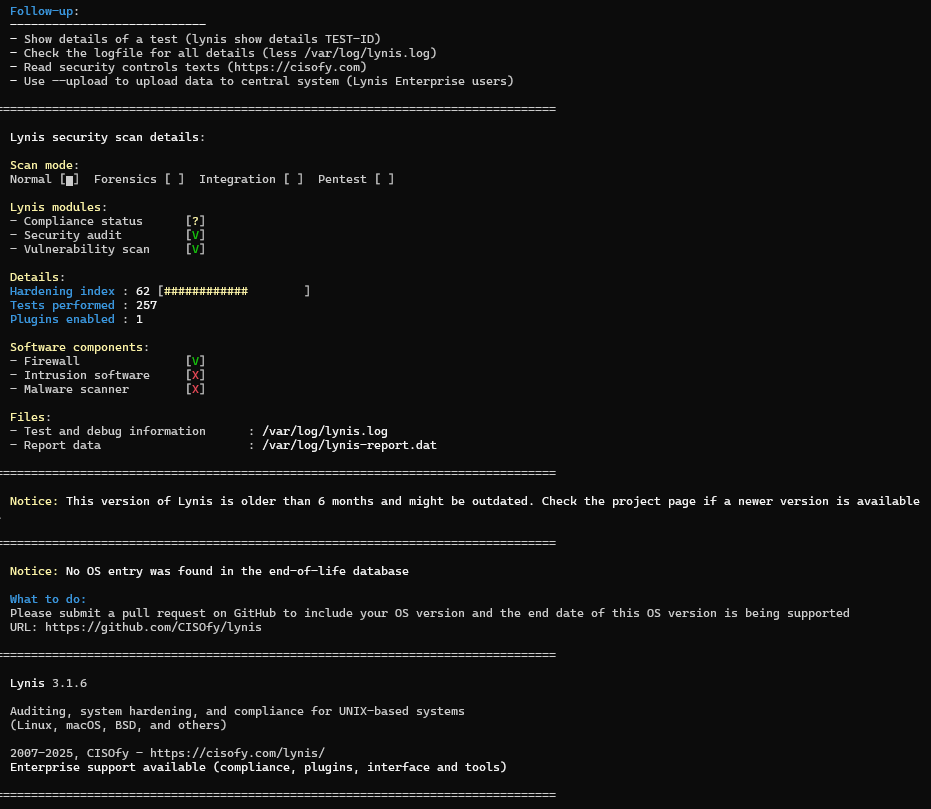

**Grösste Risiken:** fehlende Updates, Passwort-Login per SSH (Brute-Force), keine Firewall, SSH zusätzlich über ungenutztes IPv6 erreichbar.

**Auffällig:** Lynis meldet „host based firewall: ACTIVE“, obwohl UFW inaktiv ist. Man darf sich also nicht blind auf das Tool verlassen.

---

## 4. Massnahmen zur Härtung

### 4.1 Systemaktualisierung

```bash
sudo apt update && sudo apt dist-upgrade -y
sudo apt autoremove -y
```

- **Technisch:** Alle 51 Pakete werden auf den neusten Stand inkl. Sicherheitsupdates gebracht, alte Kernel-Pakete entfernt.
- **Schützt vor:** Ausnutzen bekannter Schwachstellen (CVEs), für die es öffentliche Exploits gibt (siehe Metasploitable im ersten Auftrag).
- **Prüfung:** `apt list --upgradable` → leer. `/var/run/reboot-required` existiert nicht, kein Neustart nötig.

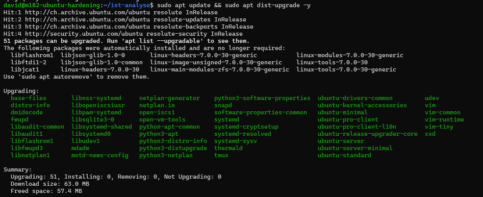

### 4.2 Neuen Administrator anlegen

```bash
sudo adduser student
sudo usermod -aG sudo student
```

- **Technisch:** Persönliches Konto mit normalen Rechten, Adminrechte nur pro Befehl über `sudo`. Jeder `sudo`-Aufruf wird mit Benutzername geloggt.
- **Schützt vor:** Vollzugriff bei einer übernommenen Session oder Schadcode, da dieser nur mit Benutzerrechten läuft. Nachvollziehbar, wer was gemacht hat.
- **Prüfung:** `id student` → `27(sudo)`. Login als `student`, `sudo whoami` → `root`.

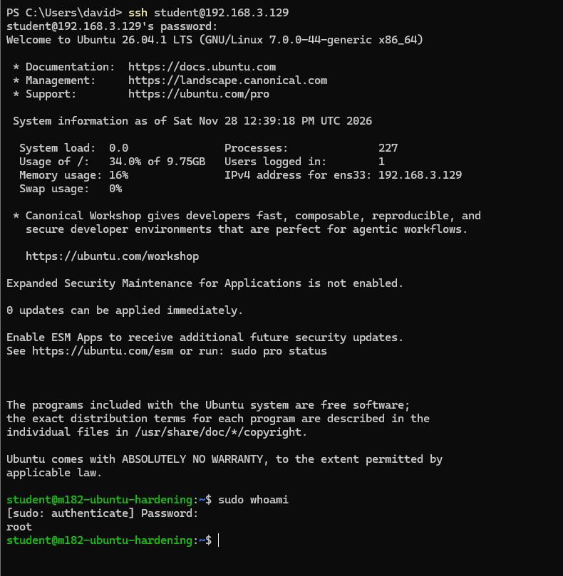

### 4.3 SSH-Root-Login verbieten

```bash
sudo nano /etc/ssh/sshd_config.d/00-hardening.conf   # PermitRootLogin no
sudo sshd -t && sudo systemctl restart ssh
```

**Abweichung vom Auftrag:** Im Ordner liegt bereits `50-cloud-init.conf`. SSH liest die Dateien alphabetisch und **der erste Wert gewinnt**. Darum heisst meine Datei `00-hardening.conf` statt `hardening.conf`.

- **Technisch:** SSH lehnt jeden Login als `root` ab, auch mit Key (vorher `prohibit-password`).
- **Schützt vor:** Brute-Force auf den bekannten Benutzernamen `root` und vor heimlich hinterlegten Keys in `/root/.ssh`.
- **Prüfung:** `sudo sshd -T | grep permitrootlogin` → `permitrootlogin no`

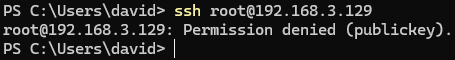

### 4.4 SSH-Passwort-Login deaktivieren

Zuerst SSH-Key auf dem Windows-Host erstellt (Ed25519 mit Passphrase), auf den Server kopiert und getestet, erst dann Passwort-Login abgeschaltet:

```powershell
ssh-keygen -t ed25519 -C "david@m182-lab"
type $env:USERPROFILE\.ssh\id_ed25519.pub | ssh student@192.168.3.129 "mkdir -p ~/.ssh && chmod 700 ~/.ssh && cat >> ~/.ssh/authorized_keys && chmod 600 ~/.ssh/authorized_keys"
```
In `00-hardening.conf` ergänzt: `PasswordAuthentication no`

`50-cloud-init.conf` enthält `PasswordAuthentication yes`. Mit dem Dateinamen aus dem Auftrag wäre der Passwort-Login **trotz Einstellung aktiv geblieben**.

- **Technisch:** Anmeldung nur noch mit privatem Schlüssel, der den PC nie verlässt.
- **Schützt vor:** Brute-Force- und Wörterbuchangriffen sowie gestohlenen Passwörtern.
- **Prüfung:** `ssh -o PubkeyAuthentication=no student@192.168.3.129` → `Permission denied (publickey).`

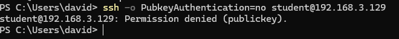

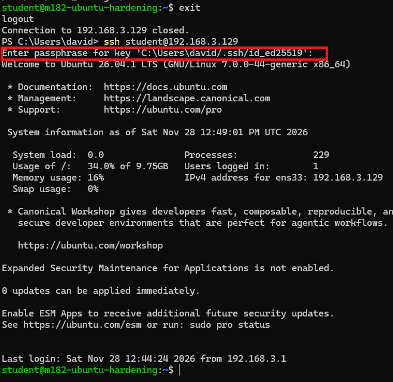

### 4.5 Firewall (UFW)

```bash
sudo ufw allow ssh
sudo ufw default deny incoming
sudo ufw enable
```
Zuerst SSH erlauben, dann aktivieren, sonst sperrt man sich aus.

- **Technisch:** Alle eingehenden Verbindungen werden verworfen, ausser 22/TCP (Default Deny).
- **Schützt vor:** Zugriff auf versehentlich geöffnete Dienste, kleinere Angriffsfläche bei Portscans.
- **Prüfung:** `sudo ufw status verbose` → `active`, `deny (incoming)`. Praxistest: Test-Webserver auf Port 8080 gestartet, vom Host `Test-NetConnection -Port 8080` → `False`, Port 22 → `True`.

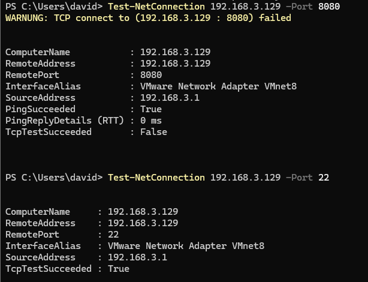

### 4.6 IPv6 deaktivieren

Zuerst wie im Auftrag über `/etc/sysctl.d/99-disable-ipv6.conf` umgesetzt. **Nach einem Neustart war IPv6 auf ens33 aber wieder aktiv** und SSH hörte weiter auf `[::]:22`. Vermutlich schaltet systemd-networkd IPv6 nach dem Booten wieder ein. Weil ich zusätzlich in UFW `IPV6=no` gesetzt hatte, war SSH über IPv6 kurzzeitig **ganz ohne Firewall** erreichbar.

Lösung: IPv6 per Kernel-Parameter abschalten.
```bash
# /etc/default/grub
GRUB_CMDLINE_LINUX_DEFAULT="ipv6.disable=1"
sudo update-grub && sudo reboot
```

- **Technisch:** Das IPv6-Subsystem wird beim Booten nicht geladen, kein Dienst kann es wieder aktivieren.
- **Schützt vor:** Angriffen über einen vergessenen, nicht überwachten Netzwerkweg (Firewall-Umgehung, gefälschte Router Advertisements).
- **Prüfung:** `cat /proc/cmdline` → `ipv6.disable=1`, `ip a | grep inet6` → leer, `ss -tuln` → kein `[::]` mehr.

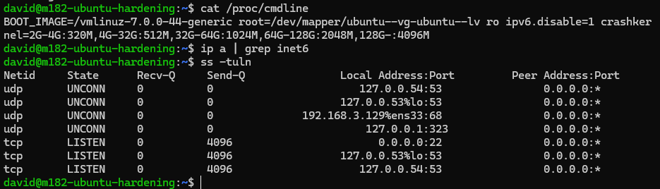

### 4.7 Unnötige Dienste entfernen

Die Pakete aus dem Auftrag waren nicht installiert (`apt purge` → „not installed“). Deshalb habe ich selbst gesucht:

| Fund | Entscheid | Begründung |
| :--- | :--- | :--- |
| `telnet` | Entfernt | Klartext-Protokoll. Lynis meldete trotzdem „OK“. |
| `ftp` | **Bewusst behalten** | `apt rdepends` zeigt: `ubuntu-standard` verlangt einen FTP-Client, apt würde `ftp-ssl` als Ersatz installieren, also kein Gewinn. Ein Client öffnet keinen Port. |
| ModemManager, multipathd | Deaktiviert + maskiert | VM hat kein Modem und kein SAN. Deaktivieren statt deinstallieren, weil sie zum Metapaket `ubuntu-server` gehören. |

```bash
sudo apt purge telnet inetutils-telnet
sudo systemctl disable --now ModemManager.service multipathd.service multipathd.socket
sudo systemctl mask ModemManager.service multipathd.service multipathd.socket
```

- **Technisch:** Weniger installierte Programme und laufende Dienste (21 → 19).
- **Schützt vor:** Ausnutzen von Lücken in Software, die niemand braucht. Ein Angreifer findet weniger Werkzeuge.
- **Prüfung:** `which telnet` → leer, `systemctl is-enabled ModemManager multipathd` → `masked`.

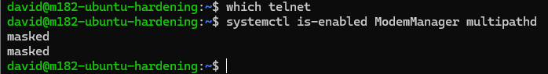

**Problem während der Arbeit:** Die VM hat sich zweimal komplett aufgehängt (`Watchdog timeout` bei udevd/networkd im Log). Beide Male kurz nach einem VMware-Snapshot im laufenden Betrieb, also vermutlich kein Problem der Härtung. Snapshots mache ich künftig nur bei ausgeschalteter VM.

---

## 5. Erfolgskontrolle & Verifikation

Analysebefehle nach allen Massnahmen erneut ausgeführt, siehe [`nachher/`](./nachher/).

| Bereich | Vorher | Nachher |
| :--- | :--- | :--- |
| Updates | 51 ausstehend | 0 |
| sudo-Gruppe | `david` | `david,student` |
| SSH root-Login | `prohibit-password` | `no` |
| SSH Passwort-Login | `yes` | `no` |
| Firewall | inactive | active, nur 22/TCP |
| SSH lauscht auf | `0.0.0.0:22` + `[::]:22` | nur `0.0.0.0:22` |
| IPv6 | aktiv | deaktiviert |
| Laufende Dienste | 21 | 19 |

Alle Massnahmen sind nach einem Neustart weiterhin aktiv.

---

## 6. Lynis-Audit: Vergleich vorher / nachher

| | Vorher | Nach 7 Massnahmen | Nach 2 Suggestions (Kap. 8) |
| :--- | :--- | :--- | :--- |
| Hardening Index | 62 | 63 | **67** |

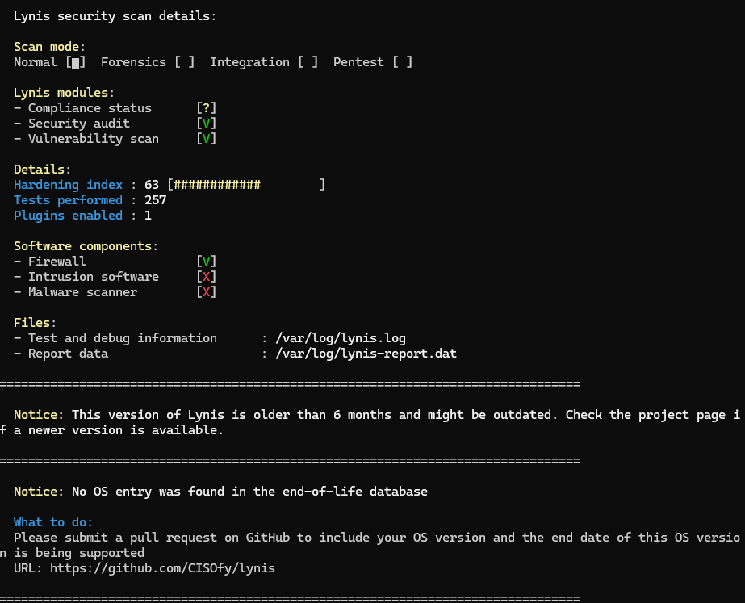

**Fazit:** Der Score ist ein Anhaltspunkt, aber kein Mass für die echte Sicherheit. Aussagekräftiger sind die eigenen Prüfungen (`sshd -T`, `ufw status`, Login ohne Key, `Test-NetConnection`).

---

## 7. Szenario Onlineshop

Der Server liefert neu den Onlineshop aus und ist **aus dem Internet erreichbar**. (Die Tabelle im Auftrag hat sieben, nicht acht Massnahmen.)

| # | Massnahme | Anpassung | Begründung |
| :--- | :--- | :--- | :--- |
| 1 | Updates | Automatische Sicherheitsupdates, Neustarts nur im **Wartungsfenster** | Schneller patchen nötig, aber der Shop muss verfügbar bleiben. |
| 2 | Admin | Zusätzlich Shop/Webserver unter **eigenem Dienstkonto** ohne sudo | Lücke im Shop gibt nur Rechte des Dienstkontos, nicht root. |
| 3 | Root-Login | 1:1 | Bots versuchen ständig `root`. |
| 4 | Passwort-Login | 1:1 + **fail2ban** | Sperrt IPs mit vielen Fehlversuchen. |
| 5 | Firewall | **80/443 für alle**, **SSH nur noch aus dem Admin-Netz/VPN** (`ufw allow from 192.168.3.0/24 to any port 22`) | Kunden brauchen HTTPS, SSH nur die IT. |
| 6 | IPv6 | **Nicht deaktivieren**, sondern mit UFW gleich absichern (`IPV6=yes`) | Viele Kunden (v. a. Mobilfunk) nutzen IPv6. Das Risiko war ungeschütztes IPv6, nicht IPv6 an sich. |
| 7 | Pakete | Strenger: auch **Compiler, snapd** entfernen, Datenbank nur auf localhost | Mit einer Webshell würden Compiler und Tools einem Angreifer helfen. |

Zusätzlich wären HTTPS-Zertifikat, Backups, Monitoring und eine **DMZ** nötig.

---

## 8. Umsetzung von zwei Lynis-Suggestions

**PKGS-7346: Konfigurationsreste entfernter Pakete löschen**
Entstanden durch `apt autoremove` (alte Kernel-Pakete im Status `rc`).
```bash
sudo apt purge '~c'
```
Prüfung: `dpkg -l | grep '^rc'` → leer.

**SSH-7408: SSH weiter härten** (in `00-hardening.conf`)

| Option | Vorher → Nachher | Nutzen |
| :--- | :--- | :--- |
| `MaxAuthTries` | 6 → 3 | Bremst Brute-Force |
| `X11Forwarding` | yes → no | Keine GUI auf dem Server |
| `AllowTcpForwarding` | yes → no | Server nicht als Tunnel ins interne Netz missbrauchbar |
| `AllowAgentForwarding` | yes → no | Kein Missbrauch des Agents eines Admins |
| `LogLevel` | INFO → VERBOSE | Log zeigt Fingerprint des verwendeten Keys |

Prüfung: `sudo sshd -T | grep -Ei 'maxauthtries|x11forwarding|allowtcpforwarding|allowagentforwarding|loglevel'`

**Bewusst nicht umgesetzt:** SSH-Port ändern. Das ist nur „Security through Obscurity“, ein Portscan findet den Dienst trotzdem, und ohne Passwort-Login bringt es kaum Gewinn.

Ergebnis: Hardening Index **67**. Die zwei kleinen Suggestions brachten +4, die sieben Massnahmen nur +1. Das bestätigt Kapitel 6.

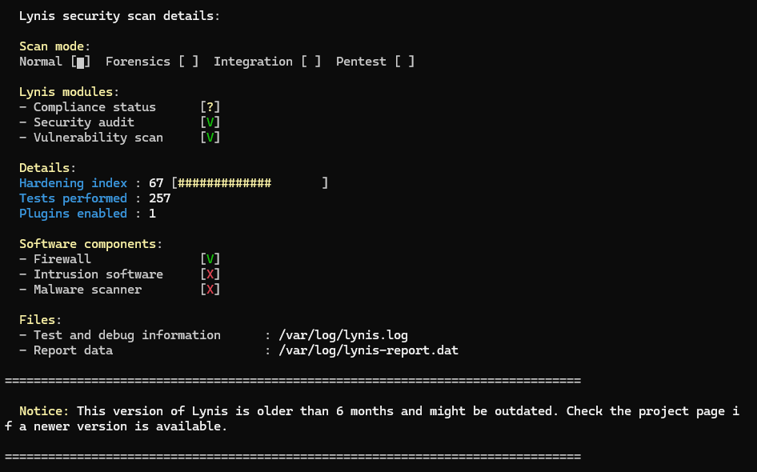

---

## 9. Reflexionsfragen

**1. Warum Härtung vor dem Go-Live?**
Ein erreichbarer Server wird sofort automatisch gescannt und angegriffen. Bei mir waren anfangs 51 Updates offen und Passwort-Login aktiv. Wird ein System vor der Härtung kompromittiert, kann man ihm nicht mehr vertrauen. Ausserdem kann man vorher Fehler machen (wie bei mir mit IPv6), ohne dass Benutzer einen Ausfall haben.

**2. Wie melde ich mich ohne Root-Login als Admin an, und warum ist das sicherer?**
Mit meinem persönlichen Benutzer und SSH-Key, dann `sudo` mit Benutzerpasswort. Ein Angreifer braucht einen gültigen Benutzernamen (statt dem bekannten `root`), den Key und zusätzlich das Passwort. Jeder `sudo`-Befehl wird mit Namen geloggt.

**3. Gefahren von ungenutztem IPv6 und offenen Ports?**
Was nicht genutzt wird, wird auch nicht überwacht, gepatcht oder in der Firewall berücksichtigt. Bei mir war SSH über IPv6 kurzzeitig ganz ohne Firewall erreichbar, obwohl ich dachte, alles sei abgesichert. Jeder offene Port ist ein möglicher Einstiegspunkt. Wie schnell man solche Dienste mit nmap findet und ausnutzt, habe ich im ersten Auftrag gesehen.